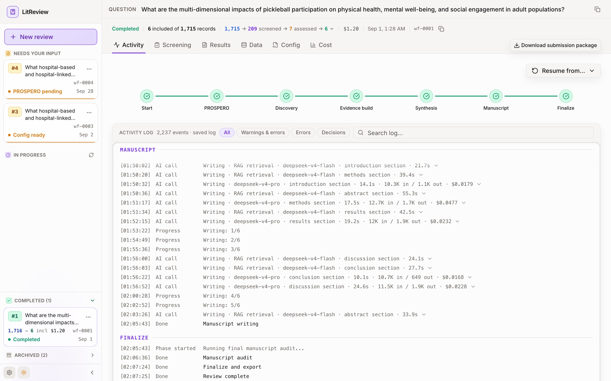
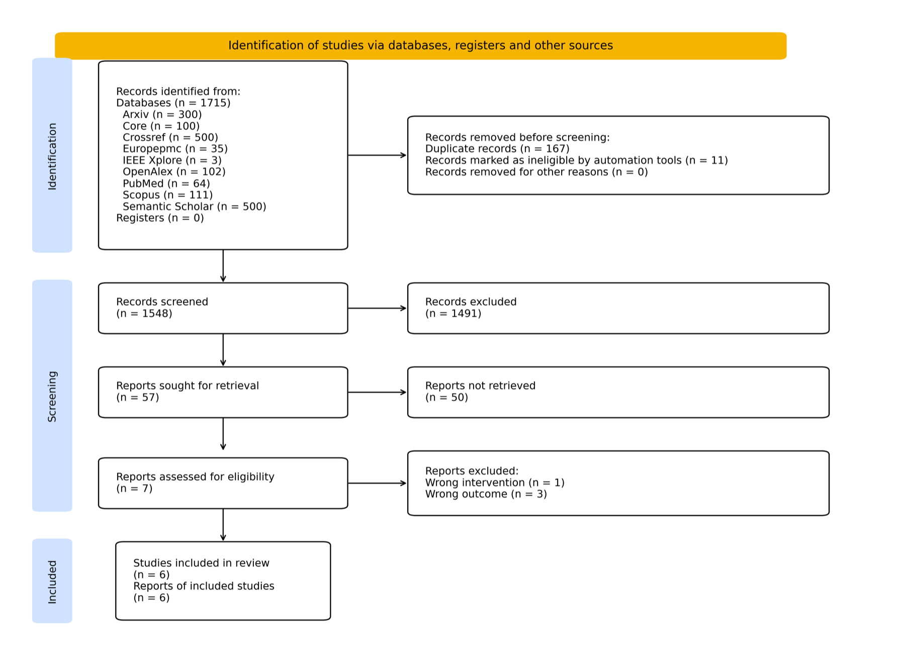

<div align="center">

<h1>LitReview</h1>

<p><b>A systematic review, from one research question.</b></p>

<p><i>Searching, screening, extracting and writing up a PRISMA review takes a team months. This runs the whole pipeline and shows its work.</i></p>

<h6>


</h6>

<a href="#how-it-works"><b>How it works</b></a> ·
<a href="#features"><b>Features</b></a> ·
<a href="#run-it"><b>Run it</b></a> ·
<a href="#reference"><b>Reference</b></a>

<br><br>



<sub>A real completed run (a review of pickleball and adult health) in the local web UI.</sub>

</div>

<br>

## The problem

A systematic review means searching half a dozen databases, removing duplicates, screening
thousands of abstracts twice, pulling data from the survivors, rating their risk of bias, and
writing it all up with a PRISMA flow diagram that adds up. Most of that is careful, repetitive
work. LitReview does it with AI reviewers and deterministic checks, keeps every decision in
SQLite, and hands back a manuscript, figures and a submission folder you can audit.

## How it works

<table>
<tr>
<td width="33%" valign="top">

**1 · Ask a question**

Type a research question. The app drafts PICO (or PCC for scoping reviews), keywords,
inclusion criteria and per-database queries as a `review.yaml` you can edit before launch.

</td>
<td width="33%" valign="top">

**2 · Search and screen**

Connectors query OpenAlex, PubMed, Crossref, Semantic Scholar, arXiv, Europe PMC and more.
Records are deduplicated, BM25-ranked, then screened by two independent AI reviewers.

</td>
<td width="33%" valign="top">

**3 · Assess and write**

Included studies get data extraction, risk of bias and GRADE, then synthesis and a
section-by-section manuscript with a citation ledger, exported to LaTeX, Word and BibTeX.

</td>
</tr>
</table>

## The paper trail

<div align="center">



<sub>The PRISMA 2020 flow diagram generated for the same run, unedited.</sub>

</div>

Every phase writes to a per-run SQLite database as it goes, so the counts in the diagram,
the Methods section and the Data tab come from the same rows. A crash or Ctrl+C resumes
from the first incomplete phase.

## Features

- **PRISMA 2020 end to end.** Search strategies appendix, flow diagram, checklist (HTML, Markdown, CSV) and a PROSPERO-format protocol.
- **Dual AI screening.** Two reviewer agents screen independently, disagreements go to an adjudicator, and Cohen's kappa is reported.
- **Cost control built in.** BM25 pre-ranking and a `max_llm_screen` cap; anything auto-excluded is disclosed as "automation tools" in PRISMA and Methods.
- **Quality appraisal by design.** Studies are routed to RoB 2, ROBINS-I, CASP or MMAT, with GRADE certainty and a summary-of-findings table.
- **Synthesis that fits the data.** Meta-analysis with forest and funnel plots when the studies allow it, narrative synthesis when they don't.
- **Grounded writing.** Sections are written from extracted data and RAG retrieval (hybrid BM25 and dense, with reranking), and a citation ledger links claims to sources.
- **Submission package.** IEEE LaTeX, PDF when `pdflatex` is installed, DOCX, `references.bib`, figures and supplementary CSVs in one `submission/` folder.
- **Human in the loop when you want it.** Optional pause after screening to approve or override AI decisions in the browser.
- **Web UI or CLI.** A React dashboard with a live activity log, per-run cost tab and data explorer, or the same pipeline from the terminal.

## Run it

Requires Python 3.11+, [uv](https://docs.astral.sh/uv/), Node 20.19+ and pnpm. LLM calls go
to [Fireworks AI](https://fireworks.ai/) by default (`FIREWORKS_API_KEY`), plus a
`GEMINI_API_KEY` for diagram images.

```bash
git clone https://github.com/parthchandak02/literature-review-assistant.git
cd literature-review-assistant
uv sync
cd frontend && pnpm install && pnpm build && cd ..
uv run uvicorn src.web.app:app --port 8001     # then open http://localhost:8001
```

Click **New review**, enter a question, generate the config, add keys (or leave blank to use
the server's `.env`), and launch. Or from the terminal:

```bash
cp .env.example .env                                         # add your keys
uv run python -m src.main run --config config/review.yaml    # full pipeline
uv run python -m src.main export --workflow-id wf-0001       # build submission/
```

A run takes roughly 20 to 60 minutes depending on how many papers are found. The run in the
screenshots screened 1,715 records for $1.20; the per-run Cost tab shows actual spend.

## Reference

<details>
<summary><b>What a run produces</b></summary>

Each run lives in `runs/YYYY-MM-DD/wf-NNNN-<topic-slug>/run_<time>/`:

- `doc_manuscript.md` and `doc_manuscript.tex` (IEEE LaTeX)
- `references.bib`
- `fig_*.png` / `fig_*.svg`: PRISMA flow, RoB traffic light, forest plot, funnel plot, timeline, geographic distribution, concept diagrams
- `runtime.db`: every record, decision, extraction and LLM call for the run

**Export** in the browser (or `src.main export`) assembles `submission/`:

- `manuscript.tex` (+ `manuscript.pdf` when local `pdflatex` succeeds) and `manuscript.docx`
- `references.bib` and `figures/`
- `supplementary/`: search strategies appendix, screening decisions CSV, extracted data CSV, PRISMA checklist (`.html`, `.md`, `.csv`)

</details>

<details>
<summary><b>Pipeline phases</b></summary>

The pipeline is a staged PydanticAI graph. Each phase checkpoints to SQLite. Canonical
checkpoint keys live in `src/orchestration/resume.py` and `docs/ARCHITECTURE.md#pipeline`.

```text
Phase 1   Foundation: load config, initialise DB, run artifacts and workflow state
Phase 2   Search + deduplication + protocol generation
Phase 3   Screening: prefilters, optional batch pre-rank, dual review, optional human gate
Phase 4   Extraction + quality assessment (RoB 2 / ROBINS-I / CASP / MMAT / GRADE routing)
Phase 4b  Embedding: RAG chunking and vector persistence
Phase 5   Synthesis: meta-analysis or narrative, plus sensitivity
Phase 5b  Knowledge graph: communities and gap signals
Phase 5c  Pre-writing gate: cohort and readiness checks
Phase 6   Writing: outline, schema-constrained sections, ratchet scoring/rewrite, deterministic render
Finalize  doc_manuscript.tex, references.bib, run_summary.json
Export    submission/ folder, zip, docx/pdf when dependencies are available
```

</details>

<details>
<summary><b>API keys</b></summary>

| Key | Where to get it | Required? |
|-----|-----------------|-----------|
| `FIREWORKS_API_KEY` | [fireworks.ai](https://fireworks.ai/) | Yes (default LLM) |
| `GEMINI_API_KEY` | [ai.google.dev](https://ai.google.dev) | Yes (diagram image agents use `google:` models) |
| `OPENALEX_API_KEY` | [openalex.org](https://openalex.org/sign-up) | If `openalex` is in `target_databases` (it is by default) |
| `PUBMED_EMAIL` | Any email address | Recommended (PubMed rate policy) |
| `PUBMED_API_KEY` | [NCBI account](https://www.ncbi.nlm.nih.gov/account/settings/) | No (higher rate limits) |
| `SEMANTIC_SCHOLAR_API_KEY` | [api.semanticscholar.org](https://api.semanticscholar.org) | No (higher rate limits) |
| `CROSSREF_EMAIL` | Any email address | No (polite crawling) |
| `IEEE_API_KEY` | [developer.ieee.org](https://developer.ieee.org) | No |
| `SCOPUS_API_KEY` | Elsevier API (institutional) | No (Scopus connector, Elsevier full text) |
| `WOS_API_KEY` | [Clarivate developer portal](https://developer.clarivate.com) | No (Web of Science Starter API) |
| `EMBASE_API_KEY` | Elsevier institutional | No (Embase connector) |
| `CORE_API_KEY` | [core.ac.uk](https://core.ac.uk/api-keys/register) | No (full text from repositories) |
| `PERPLEXITY_SEARCH_API_KEY` | [docs.perplexity.ai](https://docs.perplexity.ai) | No (auxiliary discovery) |
| `TYPESAFE_API_KEY` | TypeSafe (Jev) | No (Jev decision surfaces; fails open to the LLM when unset) |

Keys already in the backend `.env` show as "Configured on server" in the setup form; the
server never returns secret values to the browser. Some optional connectors (Embase, CORE)
read only from `.env`.

</details>

<details>
<summary><b>Configuration</b></summary>

**`config/review.yaml`**, per review:

- `research_question`, `review_type`, `pico`, `keywords`, `domain`
- `inclusion_criteria`, `exclusion_criteria`, `date_range_start`, `date_range_end`
- `target_databases` and per-database `search_overrides`
- `living_review: true` with `last_search_date` to re-search only from that date

```yaml
research_question: "How does X affect Y in population Z?"
review_type: "systematic"
pico:
  population: "..."
  intervention: "..."
  comparison: "..."
  outcome: "..."
keywords: ["keyword one", "keyword two"]
date_range_start: 2015
date_range_end: 2026
```

**`config/settings.yaml`**, rarely:

- `agents.*`: model per task (Fireworks-hosted models by default, `google:` only for diagram images); `agents.screening_reviewer_b.model` can differ from reviewer A for cross-model checks
- Screening thresholds, `max_llm_screen`, `batch_screen_enabled`, `reviewer_batch_size`
- `human_in_the_loop.enabled`: pause after screening for manual review
- `gates.manuscript_contract_mode`, `gates.manuscript_audit_mode` (`observe` / `soft` / `strict`) and `gates.audit_gate_mode` (`advisory` / `needs_revision` / `strict`)
- `jev.*`: optional TypeSafe decision surfaces, each `off` / `shadow` / `live`
- `writing.ratchet_*`: section rewrite loop limits and cost cap
- `manuscript_audit.*`, quality gate thresholds, records per database

With `max_llm_screen: 200`, every candidate is BM25-ranked against the question, the top 200
go to dual LLM review and the rest are auto-excluded and disclosed. Set it to `null` to
screen everything.

Unknown keys in `settings.yaml` are ignored with a warning. Full contracts live in `docs/`,
starting at [`docs/CONTEXT.md`](docs/CONTEXT.md).

</details>

<details>
<summary><b>CLI commands</b></summary>

```bash
uv run python -m src.main run --config config/review.yaml            # new review
uv run python -m src.main run --config config/review.yaml --debug    # also --silent, --offline, --fresh, --run-root runs/
uv run python -m src.main resume --topic "your research question"    # resume first incomplete phase
uv run python -m src.main resume --workflow-id wf-0007 --from-phase phase_3_screening
uv run python -m src.main export --workflow-id wf-0007               # submission package
uv run python -m src.main validate --workflow-id wf-0007             # IEEE + PRISMA checks
uv run python -m src.main status --workflow-id wf-0007               # status and artifact paths
uv run python -m src.main prospero --workflow-id wf-0007             # regenerate PROSPERO form
```

Ctrl+C once during screening continues with the papers already screened; twice aborts.
Re-running the same topic offers to resume.

</details>

<details>
<summary><b>Web UI and HTTP API</b></summary>

The sidebar groups runs into Needs your input (config drafts, PROSPERO registration,
screening review), In progress, Completed and Archived. A run opens with Activity (phase
timeline and event log), Screening, Results (Manuscript, Figures, Quality, Files,
References), Data, Config and Cost tabs. Resume from any phase from the Activity timeline.
See [`docs/UI.md`](docs/UI.md).

Main endpoints (full list in [`docs/API.md`](docs/API.md)):

- Setup: `GET /api/config/review`, `GET /api/config/env-keys`, `POST /api/config/generate/stream`
- Runs: `GET /api/runs`, `POST /api/run`, `POST /api/run-with-supplementary-csv`, `GET /api/stream/{run_id}`, `POST /api/cancel/{run_id}`
- History: `GET /api/history`, `POST /api/history/resume`, `POST /api/history/{workflow_id}/archive`, `GET /api/history/costs/aggregates`, `GET /api/history/costs/export`
- Results: `GET /api/run/{run_id}/artifacts`, `GET /api/run/{run_id}/manuscript`, `POST /api/run/{run_id}/export`, `GET /api/run/{run_id}/submission.zip`, `GET /api/run/{run_id}/manuscript.docx`
- Review: `GET /api/run/{run_id}/screening-summary`, `POST /api/run/{run_id}/approve-screening`, `POST /api/run/{run_id}/living-refresh`
- Data: `GET /api/db/{run_id}/papers-all`, `GET /api/db/{run_id}/costs`, `GET /api/db/{run_id}/tables`
- Health: `GET /api/health`

`run_id` can be a live session id or a durable `wf-XXXX` workflow id.

</details>

<details>
<summary><b>Development</b></summary>

```bash
# Plain terminals
uv run uvicorn src.web.app:app --reload --port 8001
cd frontend && pnpm dev                         # Vite on :5173, proxies /api to :8001

# Or PM2
cp ecosystem.config.example.js ecosystem.config.js
pm2 start ecosystem.config.js
./scripts/ops_pm2.sh restart --backend-only     # after src/ changes (PM2 does not hot-reload)
make deploy-prod                                # pnpm build + restart + health check

# Tests and lint
uv run pytest tests/unit -q
uv run pytest tests/integration -q
uv run python scripts/check.py replay-workflow --workflow-id wf-XXXX --profile quick
uv run ruff check . --fix && uv run ruff format .
cd frontend && pnpm fix && pnpm typecheck
```

In production FastAPI serves `frontend/dist/`, so rebuild the frontend after UI changes.
Utility scripts are listed in [`docs/SCRIPTS.md`](docs/SCRIPTS.md) and `./scripts/help.sh`.
Agents start at [`AGENTS.md`](AGENTS.md).

</details>

<details>
<summary><b>Project layout</b></summary>

```
src/models/           Pydantic contracts at every phase boundary
src/db/               SQLite schema, repositories, workflow registry
src/orchestration/    PydanticAI graph nodes, quality gates, resume logic
src/search/           Database connectors, deduplication, search strategy, PDF retrieval
src/screening/        Batch pre-ranker, dual reviewer, Cohen's kappa, keyword prefilter
src/extraction/       Study design classifier, data extractor
src/quality/          RoB 2, ROBINS-I, CASP, MMAT, GRADE
src/synthesis/        Feasibility check, meta-analysis, narrative synthesis
src/rag/              Chunker, embedder, hybrid retriever, HyDE, reranker
src/knowledge_graph/  Graph builder, Louvain communities, gap detector
src/writing/          Outline, section writer, grounding, guardrails
src/citation/         Citation ledger: claim to evidence to BibTeX
src/manuscript/       Readiness scorecards, contracts, audit reviewer
src/export/           IEEE LaTeX, DOCX, BibTeX, PRISMA checklist, submission packager
src/visualization/    Forest, funnel, RoB, timeline, geographic, concept diagrams
src/prisma/           PRISMA 2020 flow diagram
src/protocol/         PROSPERO-format protocol
src/web/              FastAPI backend
src/llm/              PydanticAI client, provider registry, rate limiter
frontend/             React + TypeScript web UI
config/               review.yaml and settings.yaml
```

</details>

<details>
<summary><b>Troubleshooting</b></summary>

- **`CERTIFICATE_VERIFY_FAILED`**: on macOS run `Install Certificates.command` from the Python.app folder; behind a proxy set `SSL_CERT_FILE` to your CA bundle.
- **Rate limits (429)**: requests are throttled per provider key using the RPM tiers in `config/settings.yaml`. Wait and resume, or lower the tiers.
- **"No papers found"**: check `OPENALEX_API_KEY`, `target_databases`, and the queries in `doc_search_strategies_appendix.md`; connector warnings appear in the Activity log.
- **PubMed recall dropped**: multi-word exact phrases in `search_overrides.pubmed` shrink results sharply. Prefer single words or short root forms in the second AND group.

</details>

<br>

<div align="center">
<sub>Built with PydanticAI, FastAPI, SQLite, React and Vite. MIT licensed.</sub>
</div>
